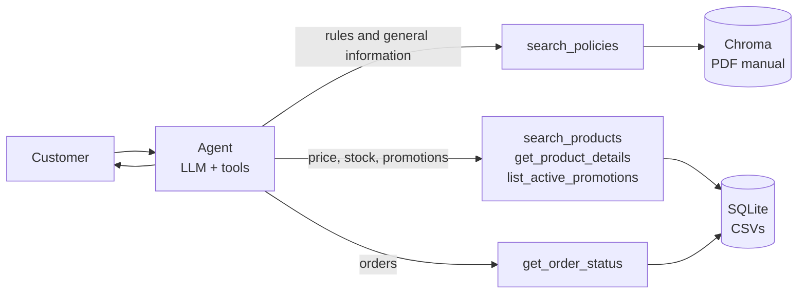

# Empório da Música: customer service agent

_English version of [README.md](README.md) (Portuguese)._

Prototype of a text-message customer service agent for Empório da Música, a fictional musical instrument store in Campo Grande/MS, Brazil. Built for Artefact's AI Engineer technical challenge.

## What the agent does

The virtual assistant is called **Clave**. It talks in Portuguese, in the informal but professional tone described in the store's manual, and answers the most common customer service questions:

- **Catalog**: searches products by category, price range and keywords, and gives the price, stock and specifications of a specific product.
- **Promotions**: lists only the promotions that are active in the system, always with the original price and the discount percentage.
- **Orders**: gives status, items, tracking code and estimated delivery, after confirming the customer's identity (order number plus the email or phone on record).
- **Store policies**: exchanges, returns, warranty, payment methods, shipping, opening hours, address and contacts, taken from the internal manual.
- **Out of scope**: politely declines requests for accessories (which the store doesn't sell) and topics unrelated to the store.

The agent decides on its own when to consult the **data** (price, stock, order) and when to consult the **policies** (rules in the manual), and combines both when the question requires it. For example, for "can I return my order?", it looks up the order and applies the 7-day rule.



## How to install and run

### Prerequisites

- Python 3.12 or later
- [uv](https://docs.astral.sh/uv/) to manage the environment
- An API key for one of the supported providers (Anthropic, Gemini or OpenRouter)

### 1. Install the dependencies

```bash
git clone https://github.com/lucasraniere/emporio-musica-chatbot.git
cd emporio-musica-chatbot
uv sync
```

### 2. Configure the model provider

```bash
cp .env.example .env
```

Open `.env` and fill in the key for the provider you choose. The default is the Anthropic API:

```
LLM_PROVIDER=anthropic
LLM_MODEL=claude-sonnet-5-5
ANTHROPIC_API_KEY=your-key
```

To use another provider, change `LLM_PROVIDER` and `LLM_MODEL` together (each provider has its own model names) and fill in the matching key. `.env.example` has all three options ready:

| Provider | `LLM_PROVIDER` | Example `LLM_MODEL` | Key |
|---|---|---|---|
| Anthropic (default) | `anthropic` | `claude-sonnet-5-5` | `ANTHROPIC_API_KEY` |
| Gemini | `google` | `gemini-3.5-flash-lite` | `GOOGLE_API_KEY` |
| OpenRouter | `openrouter` | `nvidia/nemotron-3.5-lightning:free` | `OPENROUTER_API_KEY` |

### 3. Prepare the data

The two commands below need to be run once. They create the `storage/` folder with the SQLite database (from the CSVs) and the vector index (from the policies PDF).

```bash
uv run python -m emporio.ingest.build_db
```

```bash
uv run python -m emporio.ingest.build_index
```

On its first run, the second command downloads the embedding model (`intfloat/multilingual-e5-base`, about 1 GB). Embeddings run locally, with no API key.

### 4. Chat in the terminal

```bash
uv run emporio
```

Each lookup the agent makes is shown on a dim line before the answer (`↳ consultando search_products(...)`), so you can see which source it used. To leave, type `sair`.

Options:

| Option | What it does |
|---|---|
| `--thread ID` | Continues an earlier conversation. The ID is shown at the start and end of each conversation. |
| `--save file.md` | Saves the conversation as Markdown on exit. This is how the examples in this repository were generated. |

Conversation history is stored in `storage/checkpoints.db`.

### 5. Run in LangSmith Studio (optional)

Studio shows the agent's graph and each step of a run (model calls, tools, arguments and results). You need a [LangSmith](https://smith.langchain.com/) account and the `LANGSMITH_API_KEY` variable in `.env`.

```bash
uv run langgraph dev
```

The command starts a local server at `http://127.0.0.1:2024` and opens Studio in the browser. In Safari and Brave, which block access to `localhost`, use `uv run langgraph dev --tunnel`.

With `LANGSMITH_TRACING=true` in `.env`, conversations held in the terminal are also recorded in LangSmith.

### Simulating a date

The sample orders are from late 2025 and early 2026, so today all of them are outside the return windows. To demonstrate a return inside the window, set `REFERENCE_DATE` (format `YYYY-MM-DD`):

```bash
REFERENCE_DATE=2026-02-20 uv run emporio
```

## Example conversations

The [examples/](examples/) folder has five real conversations with the agent, recorded with `--save`. They are in Portuguese, the language the agent speaks:

| File | Scenario |
|---|---|
| [01-violoes-ate-1000.md](examples/01-violoes-ate-1000.md) | Catalog query with filters and a recommendation |
| [02-endereco-loja.md](examples/02-endereco-loja.md) | Introduction, address and opening hours |
| [03-consulta-preco.md](examples/03-consulta-preco.md) | Price of a product and an out-of-scope question |
| [04-arrependimento.md](examples/04-arrependimento.md) | Non-trivial case: return policy combined with an order lookup |
| [05-multiplos-temas.md](examples/05-multiplos-temas.md) | Out-of-stock product, non-existent promotion, accessories and PIX |

## Technical decisions

### Framework: LangChain and LangGraph

I chose LangChain/LangGraph because it is the framework I have worked with before and know best. I also like LangSmith Studio, which makes it much easier to see what the agent is doing at each step.

The agent is a simple graph with two nodes: `agent` calls the model with the available tools, and `tools` runs the calls and returns the result, in a loop, until the model answers in text. History is persisted per conversation with LangGraph's SQLite checkpointer.

### Model and provider

I started with free models, through OpenRouter and the Gemini API, but they couldn't get through the tests: OpenRouter ran out of its daily free-request limit in the middle of a test run, and the newest Gemini Flash models returned overload errors (503). So I moved to a paid Anthropic model (`claude-sonnet-5-5`), which is the project's default.

All three providers remain supported, and switching is done in `.env` only, without touching the code.

### Retrieval architecture

The split follows the nature of each source:

- **Operational data (CSVs) goes to SQL.** Questions like "acoustic guitars up to R$ 1,000 in stock" are numeric filters, and SQL handles numbers better than a similarity search. The CSVs are loaded into SQLite with keys and constraints, and a view (`product_catalog`) already provides category, active promotion, final price and PIX price.
- **Policies (PDF) go to RAG.** The manual is running text, and customers' questions rarely use the same words as the document. The PDF is converted to Markdown, split by section (26 chunks) and indexed in Chroma.

Some details of this implementation:

- The agent doesn't write SQL. It calls tools with typed parameters, and the database is opened read-only. This avoids wrong queries and prevents direct access to the customers table.
- Arithmetic stays in the code, not in the model: promotional price, PIX price and days since delivery are computed in SQL and in the tools.
- An order lookup requires the order number plus email or phone. If they don't match, the answer is the same as for an order that doesn't exist.
- The first embedding model (`multilingual-e5-small`) missed simple questions. With `multilingual-e5-base`, the correct section appeared in the top 6 results for 17 of 18 test questions.

### Prompt strategy

The strategy was simple: a single system prompt that describes how the agent should behave. It defines the persona and tone, says which tool to use for each kind of question, lists the rules that can't be broken (don't state price or stock without looking it up, don't promise a promotion the system doesn't show, don't make things up) and sets the scope.

The current date and time go into the prompt on every message, so the agent knows whether the store is open and can assess deadlines. The tool descriptions are also part of the strategy, because they are how the model decides which one to call.

### Interface and persistence

The interface is a CLI, since the challenge's focus is the agent. History is saved per conversation, which makes it possible to resume a conversation with `--thread`.

## Assumptions

The brief asks for ambiguities to be resolved and documented:

- **Delivery date**: orders only have an estimated delivery date, not the actual one. I used the estimate as the date of receipt to count return and warranty periods.
- **Promotions**: the manual mentions campaigns (Black Friday, Semana do Músico and others), but the promotions table marks most of them as inactive. The agent considers only what is active in the system.
- **Order totals**: in two orders the total doesn't match the items' current prices. I treated the order total as the historical amount paid.
- **Availability**: a product is only offered if it is active and in stock. Discontinued or "coming soon" items are not sold, even with stock on record.
- **Empty categories**: the manual mentions more than 300 instruments and includes wind instruments and orchestral strings, but the data has 65 products and none in those categories. The agent says there are no products registered.
- **Contacts**: the manual gives two phone numbers and two spellings of the email address. The agent repeats what the retrieved passage of the manual says.
- **Size of the manual**: at 8 pages, the manual would fit entirely in the prompt. I kept RAG because the approach still works if the document grows, and because each answer stays tied to a section of the manual.

## Known limitations and next steps

- **Keyword product search**: the catalog search compares words, not meaning. With more time, I would add semantic search over the product descriptions.
- **No automated tests**: testing was done by calling the tools directly and with a set of 13 conversation scenarios. The next step would be to turn those scenarios into an automated evaluation.
- **Long lists**: the search returns at most 10 products, and the agent doesn't always say that there are more results.
- **Complaints**: the agent acknowledges the complaint and says it will forward it, but there is no real record and no handoff to a human attendant.
- **Failure mid-conversation**: if the model API fails, the customer's message stays in the history without an answer.
- **Shipping**: the agent explains the shipping rules, but doesn't calculate the cost by postal code.
- **Model dependence**: smaller models made mistakes that the current model doesn't, such as mentioning an inactive campaign. Answer quality depends on the model chosen.
- **Channel**: it is a CLI. Real use would still need the WhatsApp integration and the out-of-hours handling described in the manual.

## Use of coding assistants

I used **Claude Code**, the tool I use in my current job and in day-to-day tasks.

In this challenge, I didn't let the assistant write the project for me, because I didn't think that would be fair to the evaluation. I used Claude Code to:

- **Define the architecture**: discuss the approach (RAG for policies, SQL for data), the project structure and the build order.
- **Ask questions and get tips**: for each step, I asked for tips and talked things through to decide the best ways of doing it, and I also asked Claude to look for improvements (chat only, with no code editing).
- **Test and review**: check the generated database and index, test each tool and run the conversation scenarios end to end. Several of my own mistakes were found this way, such as a wrong path in the configuration and broken imports.

The code written directly by Claude was concentrated in the command-line interface (`cli.py`) and in writing this README. It also made the small adjustments recorded in the log: the configuration of the Gemini and Anthropic providers, a wording fix in one tool, the headers of the examples and `.env.example`.

The full record of the tasks I asked the assistant to do is in [AI_TASKS.md](AI_TASKS.md).

## Project structure

```
data/                    Operational CSVs and the policies PDF
examples/                Example conversations
src/emporio/
  config.py              Settings (provider, paths, reference date)
  db_helper.py           Read-only queries on SQLite
  cli.py                 Terminal chat
  ingest/
    build_db.py          CSVs -> SQLite
    build_index.py       PDF -> Chroma
  rag/embeddings.py      Embedding model and access to the index
  tools/                 The agent's five tools
  agent/
    prompts.py           System prompt
    graph.py             LangGraph graph
    studio.py            Entry point for LangSmith Studio
langgraph.json           LangSmith Studio configuration
AI_TASKS.md              Log of coding-assistant usage
```
