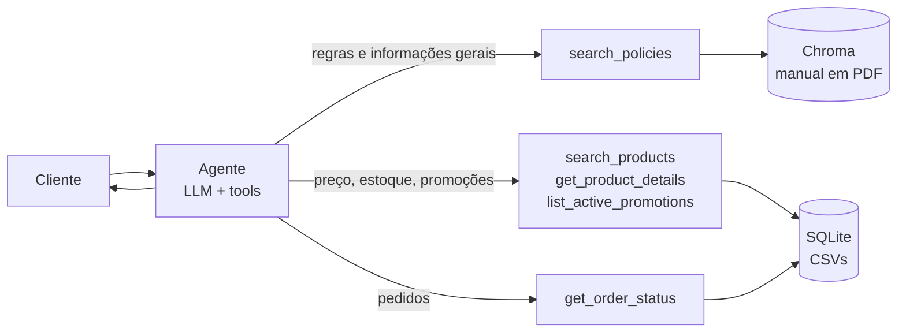

# Empório da Música: agente de atendimento

Protótipo de um agente de atendimento por mensagens de texto para a Empório da Música, loja fictícia de instrumentos musicais em Campo Grande/MS. Desenvolvido para o desafio técnico de AI Engineer da Artefact.

## O que o agente faz

A assistente virtual se chama **Clave**. Ela conversa em português, com o tom informal e profissional descrito no manual da loja, e responde às perguntas mais comuns do atendimento:

- **Catálogo**: busca produtos por categoria, faixa de preço e palavras-chave, e informa preço, estoque e especificações de um produto específico.
- **Promoções**: lista apenas as promoções ativas no sistema, sempre com preço original e percentual de desconto.
- **Pedidos**: informa status, itens, rastreio e previsão de entrega, depois de confirmar a identidade do cliente (número do pedido mais e-mail ou telefone do cadastro).
- **Políticas da loja**: trocas, devoluções, garantia, formas de pagamento, frete, horários, endereço e contatos, a partir do manual interno.
- **Fora do escopo**: recusa com educação pedidos de acessórios (que a loja não vende) e assuntos sem relação com a loja.

O agente decide sozinho quando consultar os **dados** (preço, estoque, pedido) e quando consultar as **políticas** (regras do manual), e combina os dois quando a pergunta exige. Por exemplo, em "posso devolver meu pedido?", ele consulta o pedido e aplica a regra de 7 dias.



## Como instalar e rodar

### Pré-requisitos

- Python 3.12 ou superior
- [uv](https://docs.astral.sh/uv/) para gerenciar o ambiente
- Uma chave de API de um dos provedores suportados (Anthropic, Gemini ou OpenRouter)

### 1. Instalar as dependências

```bash
git clone https://github.com/lucasraniere/emporio-musica-chatbot.git
cd emporio-musica-chatbot
uv sync
```

### 2. Configurar o provedor do modelo

```bash
cp .env.example .env
```

Abra o `.env` e preencha a chave do provedor escolhido. O padrão é a API da Anthropic:

```
LLM_PROVIDER=anthropic
LLM_MODEL=claude-sonnet-5-5
ANTHROPIC_API_KEY=sua-chave
```

Para usar outro provedor, troque `LLM_PROVIDER` e `LLM_MODEL` juntos (cada provedor tem seus próprios nomes de modelo) e preencha a chave correspondente. O `.env.example` traz as três opções prontas:

| Provedor | `LLM_PROVIDER` | Exemplo de `LLM_MODEL` | Chave |
|---|---|---|---|
| Anthropic (padrão) | `anthropic` | `claude-sonnet-5-5` | `ANTHROPIC_API_KEY` |
| Gemini | `google` | `gemini-3.5-flash-lite` | `GOOGLE_API_KEY` |
| OpenRouter | `openrouter` | `nvidia/nemotron-3.5-lightning:free` | `OPENROUTER_API_KEY` |

### 3. Preparar os dados

Os dois comandos abaixo precisam ser executados uma vez. Eles criam a pasta `storage/` com o banco SQLite (a partir dos CSVs) e o índice vetorial (a partir do PDF de políticas).

```bash
uv run python -m emporio.ingest.build_db
```

```bash
uv run python -m emporio.ingest.build_index
```

Na primeira execução, o segundo comando baixa o modelo de embeddings (`intfloat/multilingual-e5-base`, cerca de 1 GB). Os embeddings rodam localmente, sem chave de API.

### 4. Conversar pelo terminal

```bash
uv run emporio
```

Cada consulta feita pelo agente aparece em uma linha discreta antes da resposta (`↳ consultando search_products(...)`), o que permite ver qual fonte ele usou. Para sair, digite `sair`.

Opções:

| Opção | Para que serve |
|---|---|
| `--thread ID` | Continua uma conversa anterior. O ID é exibido no início e no fim de cada conversa. |
| `--save arquivo.md` | Salva a conversa em Markdown ao sair. Foi assim que os exemplos deste repositório foram gerados. |

O histórico das conversas fica em `storage/checkpoints.db`.

### 5. Rodar no LangSmith Studio (opcional)

O Studio mostra o grafo do agente e cada passo da execução (chamadas ao modelo, tools, argumentos e resultados). É necessário ter uma conta no [LangSmith](https://smith.langchain.com/) e a variável `LANGSMITH_API_KEY` no `.env`.

```bash
uv run langgraph dev
```

O comando sobe um servidor local em `http://127.0.0.1:2024` e abre o Studio no navegador. No Safari e no Brave, que bloqueiam o acesso a `localhost`, use `uv run langgraph dev --tunnel`.

Com `LANGSMITH_TRACING=true` no `.env`, as conversas feitas pelo terminal também ficam registradas no LangSmith.

### Simular uma data

Os pedidos de exemplo são do fim de 2025 e início de 2026, então hoje todos estão fora dos prazos de devolução. Para demonstrar uma devolução dentro do prazo, defina `REFERENCE_DATE` (formato `AAAA-MM-DD`):

```bash
REFERENCE_DATE=2026-02-20 uv run emporio
```

## Exemplos de conversas

A pasta [examples/](examples/) tem cinco conversas reais com o agente, gravadas com `--save`:

| Arquivo | Cenário |
|---|---|
| [01-violoes-ate-1000.md](examples/01-violoes-ate-1000.md) | Consulta ao catálogo com filtros e recomendação |
| [02-endereco-loja.md](examples/02-endereco-loja.md) | Apresentação, endereço e horários |
| [03-consulta-preco.md](examples/03-consulta-preco.md) | Preço de um produto e pergunta fora do escopo |
| [04-arrependimento.md](examples/04-arrependimento.md) | Caso não trivial: política de devolução combinada com consulta de pedido |
| [05-multiplos-temas.md](examples/05-multiplos-temas.md) | Produto sem estoque, promoção inexistente, acessórios e PIX |

## Decisões técnicas

### Framework: LangChain e LangGraph

Escolhi LangChain/LangGraph por ser o framework com que já trabalhei e que conheço melhor. Também gosto do LangSmith Studio, que facilita muito enxergar o que o agente está fazendo a cada passo.

O agente é um grafo simples com dois nós: `agent` chama o modelo com as tools disponíveis e `tools` executa as chamadas e devolve o resultado, em laço, até o modelo responder em texto. O histórico é persistido por conversa com o checkpointer SQLite do LangGraph.

### Modelo e provedor

Comecei tentando modelos gratuitos, pelo OpenRouter e pela API do Gemini, mas eles não aguentaram os testes: o OpenRouter esgotou o limite diário de requisições gratuitas no meio de uma bateria de testes, e os modelos Flash mais novos do Gemini devolviam erros de sobrecarga (503). Por isso passei a usar um modelo pago da Anthropic (`claude-sonnet-5-5`), que é o padrão do projeto.

Os três provedores continuam suportados e a troca é feita só pelo `.env`, sem mexer no código.

### Arquitetura de retrieval

A separação segue a natureza de cada fonte:

- **Dados da operação (CSVs) vão para SQL.** Perguntas como "violões até R$ 1.000 em estoque" são filtros numéricos, e SQL funciona melhor com números do que uma busca por similaridade. Os CSVs são carregados em um SQLite com chaves e restrições, e uma view (`product_catalog`) já entrega categoria, promoção ativa, preço final e preço no PIX.
- **Políticas (PDF) vão para RAG.** O manual é texto corrido, e as perguntas dos clientes raramente usam as mesmas palavras do documento. O PDF é convertido para Markdown, dividido por seção (26 trechos) e indexado no Chroma.

Alguns detalhes dessa implementação:

- O agente não escreve SQL. Ele chama tools com parâmetros tipados, e o banco é aberto somente para leitura. Isso evita consultas erradas e impede o acesso direto à tabela de clientes.
- Contas ficam no código, não no modelo: preço promocional, preço no PIX e dias desde a entrega são calculados no SQL e nas tools.
- A consulta de pedido exige número do pedido mais e-mail ou telefone. Se não conferir, a resposta é a mesma de um pedido inexistente.
- O modelo de embeddings inicial (`multilingual-e5-small`) errava perguntas simples. Com o `multilingual-e5-base`, a seção correta apareceu entre os 6 primeiros resultados em 17 de 18 perguntas de teste.

### Estratégia de prompt

A estratégia foi simples: um único prompt de sistema que descreve como o agente deve se comportar. Ele define a persona e o tom, diz qual tool usar para cada tipo de pergunta, lista as regras que não podem ser quebradas (não informar preço ou estoque sem consultar, não prometer promoção que o sistema não mostra, não inventar) e delimita o escopo.

A data e a hora atuais entram no prompt a cada mensagem, para o agente saber se a loja está aberta e avaliar prazos. As descrições das tools também fazem parte da estratégia, porque é por elas que o modelo decide qual consultar.

### Interface e persistência

A interface é um CLI, já que o foco do desafio é o agente. O histórico é salvo por conversa, o que permite retomar um atendimento com `--thread`.

## Suposições

O enunciado pede que as ambiguidades sejam resolvidas e documentadas:

- **Data de entrega**: os pedidos só têm previsão de entrega, não a data real. Usei a previsão como data de recebimento para contar os prazos de devolução e garantia.
- **Promoções**: o manual cita campanhas (Black Friday, Semana do Músico etc.), mas a tabela de promoções marca a maioria como inativa. O agente considera somente o que está ativo no sistema.
- **Valor dos pedidos**: em dois pedidos o total não bate com o preço atual dos itens. Tratei o total do pedido como o valor histórico pago.
- **Disponibilidade**: um produto só é oferecido se estiver ativo e com estoque. Itens descontinuados ou "em breve" não são vendidos, mesmo com estoque registrado.
- **Categorias vazias**: o manual fala em mais de 300 instrumentos e inclui sopros e cordas orquestrais, mas os dados têm 65 produtos e nenhum nessas categorias. O agente informa que não há produtos cadastrados.
- **Contatos**: o manual traz dois telefones e duas grafias de e-mail. O agente repete o que o trecho recuperado do manual informar.
- **Tamanho do manual**: com 8 páginas, o manual caberia inteiro no prompt. Mantive o RAG porque a abordagem continua funcionando se o documento crescer e porque cada resposta fica ligada a uma seção do manual.

## Limitações conhecidas e próximos passos

- **Busca de produtos por palavra-chave**: a busca no catálogo compara palavras, não significado. Com mais tempo, adicionaria busca semântica sobre as descrições dos produtos.
- **Sem testes automatizados**: os testes foram feitos chamando as tools diretamente e com uma bateria de 13 cenários de conversa. O próximo passo seria transformar esses cenários em uma avaliação automatizada.
- **Listas longas**: a busca devolve no máximo 10 produtos, e o agente nem sempre avisa que existem mais resultados.
- **Reclamações**: o agente acolhe a reclamação e diz que vai encaminhar, mas não existe um registro real nem transferência para um atendente humano.
- **Falha no meio de uma conversa**: se a API do modelo falha, a mensagem do cliente fica no histórico sem resposta.
- **Frete**: o agente explica as regras de frete, mas não calcula o valor por CEP.
- **Dependência do modelo**: modelos menores cometeram erros que o modelo atual não comete, como citar uma campanha inativa. A qualidade das respostas depende do modelo escolhido.
- **Canal**: é um CLI. Para uso real, faltaria a integração com o WhatsApp e o atendimento fora do horário descrito no manual.

## Uso de assistentes de código

Usei o **Claude Code**, que é a ferramenta que uso no meu trabalho atual e nas tarefas do dia a dia.

Neste desafio, não deixei o assistente escrever o projeto por mim, porque não achei justo com a avaliação. Usei o Claude Code para:

- **Definir a arquitetura**: discutir a abordagem (RAG para políticas, SQL para dados), a estrutura do projeto e a ordem de construção.
- **Tirar dúvidas e pedir dicas**: para cada etapa, pedi dicas e comversei para definir as melhores formas de fazer, e também pedi para o Claude buscar por melhorias (chat sem edição de código).
- **Testar e revisar**: conferir o banco e o índice gerados, testar cada tool e rodar os cenários de conversa de ponta a ponta. Vários erros meus foram encontrados assim, como um caminho errado na configuração e imports quebrados.

O código escrito diretamente pelo Claude se concentrou na interface de linha de comando (`cli.py`) e na criação deste README. Ele também fez ajustes pontuais registrados no log: a configuração dos provedores Gemini e Anthropic, uma correção de texto em uma tool, os cabeçalhos dos exemplos e o `.env.example`.

O registro completo das tarefas que pedi ao assistente está em [AI_TASKS.md](AI_TASKS.md).

## Estrutura do projeto

```
data/                    CSVs da operação e o PDF de políticas
examples/                Conversas de exemplo
src/emporio/
  config.py              Configurações (provedor, caminhos, data de referência)
  db_helper.py           Consulta somente leitura ao SQLite
  cli.py                 Chat pelo terminal
  ingest/
    build_db.py          CSVs -> SQLite
    build_index.py       PDF -> Chroma
  rag/embeddings.py      Modelo de embeddings e acesso ao índice
  tools/                 As cinco tools do agente
  agent/
    prompts.py           Prompt de sistema
    graph.py             Grafo LangGraph
    studio.py            Ponto de entrada para o LangSmith Studio
langgraph.json           Configuração do LangSmith Studio
AI_TASKS.md              Log de uso do assistente de código
```
